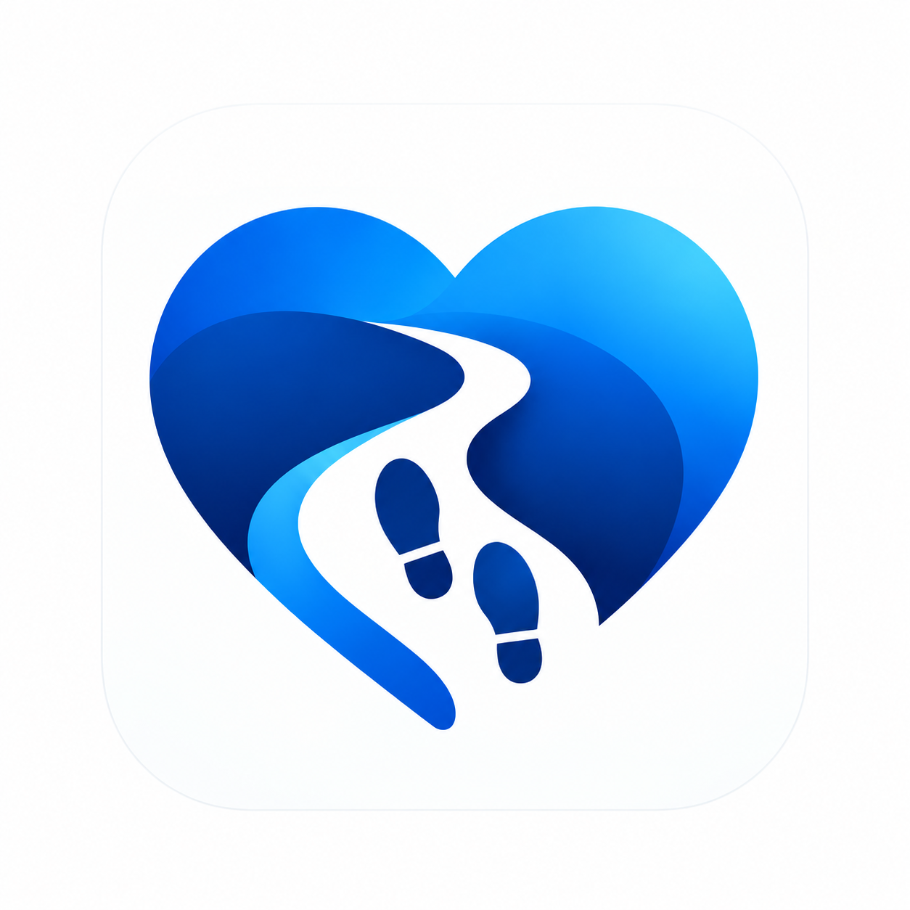

# WalkWithMe



A phone and watch app for timed safety check-ins. A trusted guardian can view the recorded trail after a missed check-in, or throughout a session when live sharing is enabled.

Built with Flutter for Android and iOS, plus a native Wear OS companion. Tested on a **Vivo X300 Ultra** and **Galaxy Watch4**.

## Current capabilities

| Feature | Current behavior and limits |
| --- | --- |
| Safety sessions | Server-confirmed phone/watch check-ins, grace periods, guardian pairing, optional live sharing, revocation and expiry. No emergency dispatch or medical detection. |
| Pocket motion | Experimental relative movement from Android sensors, with optional watch activity checks. Recording starts anywhere without a manual calibration walk. Room, floor, geographic origin and north remain unknown; walking accuracy is unverified. |
| Indoor camera | **Camera + motion diagram (no indoor AR)** shows a local camera and a separate relative diagram. It cannot align a trail to the floor or navigate between rooms. |
| Outdoor camera | Experimental ARKit/ARCore alignment needs accurate outdoor positions and a 30–100 m registration walk. Optional Android Geospatial and approximate GPS/compass preview have separate requirements. Physical accuracy remains unverified. |

A freely pocketed phone does not see the rooms it passes through. Its inertial sensors can estimate relative movement, but cannot identify an arbitrary starting room or match that movement to a second phone's camera. Walking around alone does not create a visual indoor map in this build. No advance mapping is needed for relative recording; universal pocket-only indoor AR localization is not implemented.

## Run

Requires Node.js 22.13 or newer.

```powershell
npm.cmd install
npm.cmd start
```

The app contains its HTTPS service address; users do not enter a backend URL. Keep the backend running while using WalkWithMe. For access from another phone, expose it through an HTTPS tunnel or host it behind HTTPS. A temporary tunnel address changes when restarted. For developer builds, set `KAZE_BASE_URL` at build time to match that address; use a stable named HTTPS hostname before distributing the app.

For local development, use `npm.cmd start` at `http://127.0.0.1:4173`. See [network setup](docs/PC_BACKEND.md).

## Build

```powershell
cd mobile
flutter pub get
flutter build apk --debug
cd ..
.\android\gradlew.bat -p android :watch:assembleDebug
```

[Phone, watch and iPhone setup](docs/FLUTTER_MOBILE.md).

## Use

Start a session on the phone and open WalkWithMe on the paired watch. In Settings, choose **Show guardian QR code**. Your guardian chooses **Scan QR code** on their iPhone or Android, or enters the short pairing code. Codes work once for five minutes; both phones must use the same WalkWithMe service. The watch uses the phone's Bluetooth connection; the phone can use Wi-Fi or cellular data. See [guardian pairing](docs/GUARDIAN_PAIRING.md).

Android phone and Wear OS check-in reminders request six vibration pulses over eight seconds, with an active watch receiving the reminder first and the phone as fallback. Existing vibration opt-outs, notification settings and system restrictions still apply. iPhone vibration duration is controlled by iOS.

Wearer recording runs on Android. Android guardians can opt into **Background guardian alerts** after joining: a visible native service checks server status and posts a notification after confirmed nonresponse, even while the Flutter screen is closed. Allow notifications and background battery use. Network loss is reported separately; it never becomes a presumed safety alert. Force-stop, reboot, restricted battery use or blocked notifications can interrupt delivery. Reopen WalkWithMe and re-enable monitoring after force-stop or reboot. This is background polling, not remote push.

iPhone guardians can opt into local review reminders using a free Apple Account signed build. These reminders use the last known deadline and cannot confirm nonresponse or notice a later check-in while WalkWithMe is closed. Reopen WalkWithMe to verify current status. Native Apple push registration and server delivery are implemented as an optional path requiring paid Apple Developer membership, push-capable signing and server credentials; they are disabled by default. The new native iOS notification code still needs an Xcode build and physical-device verification. See [iPhone setup](docs/FLUTTER_MOBILE.md#iphone), [Apple push setup](docs/IOS_NOTIFICATIONS.md) and the [iPhone regression instructions](docs/FLUTTER_MOBILE.md#ios-simulator-regression-suite). Calls, SMS, backup-contact escalation and emergency dispatch are not implemented.

Experimental [guardian spatial AR](docs/AR_BACKEND.md) uses native ARKit/RealityKit or ARCore and a measured outdoor walking baseline to align a recorded trail with the camera. It draws continuous trail sections with live direction and distance cues; unknown heights use a labeled floating horizontal guide. Poor registration and excessive horizontal uncertainty require the map. Ground, floors and obstacles are not detected. Physical accuracy and two-phone operation still need verification. The separate compass preview remains unregistered.

[Motion trail evaluation](docs/MOTION_EVALUATION.md) starts automatically with wearer sessions and sends compressed batches over Wi-Fi or cellular. With explicit retention consent, continuous supported batches form a shared relative research diagram under the session's guardian access rules. Gaps and recorder restarts start separate sections with unknown origins. This never becomes geographic evidence or changes check-in behavior. Automatic streaming saves no raw capture; optional private captures support measured comparisons.

Owner-only tuning diagnostics retain at most 120 batch summaries with consent. Copy them from **Settings → Motion trail evaluation → Copy motion diagnostics** before ending a house test. They report sampling, gaps, model timing, stationary decisions and watch checks, excluding raw samples, coordinates and credentials. They do not train the model or prove accuracy. Relative history is bounded to 4096 points/128 sections; consent withdrawal, expiry and deletion clear the relevant retained records. The motion checkpoint is subject to separate non-commercial research terms; see the motion guide for provenance and licensing.

See [filming and indoor test instructions](docs/DEMO_FILMING.md), [iPhone build instructions](docs/FLUTTER_MOBILE.md#iphone) and the [Devpost project story](docs/DEVPOST.md).
